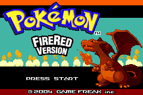
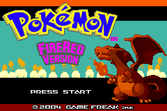
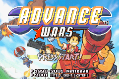
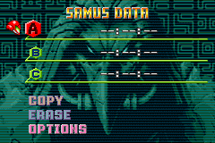
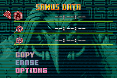
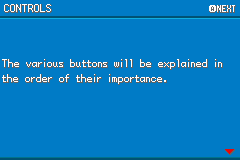
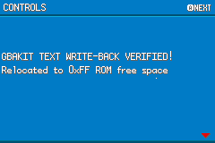

# gbakit

A clean-room Game Boy Advance (GBA) format toolkit in Rust built on **[Formatkit](https://github.com/JidouGhost-TL/formatkit)** (`=0.1.10`).

- **Documentation & GBA Research Wiki:** **https://jidoughost-tl.github.io/gbakit/** & **[GitHub Wiki](https://github.com/JidouGhost-TL/gbakit/wiki)** — **3,409 / 3,409** unique GBA ROMs accounted for (3,052 retail + 357 non-retail incl. 32 GBA Video carts), **814 / 814** saving families (1,543 saving ROMs = 100%), **82** verified interactive debug-menu `.ips` micro-patches, **193** verified button-combo cheats (with per-game before/after screenshots), **13** byte-exact standalone GBA synth crates, **2** standalone non-synth format crates (`gba-ereader`, `mobiclip`), 91 Engine/SDK communities, live VRAM/PRAM probes, and DirectSound PCM scans.

## Workspace Crates

| Crate | Responsibility |
| --- | --- |
| `gba-rom` | Checked 192-byte AGB headers, complement checksum, `0x08000000` bus mapping, SDK backup tags, ROM pointer-table scanner, Multiboot (`0x02000000`) helpers |
| `gba-compress` | Complete GBA BIOS codecs: LZ77 (`0x10` WRAM/VRAM), LZ11, RLE (`0x30`), Huffman 4/8-bit decode & encode (`0x24`/`0x28`), `BitUnPack` (`SWI 0x10`), `Diff8`/`Diff16` (`0x81`/`0x82`), plus studio codecs (Hudson LZ, Konami Dict, Shin'en Mode 7) |
| `gba-gfx` | `BGR555` palettes, allocation-free 4bpp/8bpp tiles, **4bpp/8bpp graphics ripper & write-back** (PNG/PPM → 4bpp/8bpp tiles + BGR555 palette + BIOS recompression + in-place/relocated ROM patching), OAM sprites & affine matrices (`ObjAttr`/`ObjAffine`), text BG compositor, Mode 3/4 framebuffers, 1bpp/2bpp font glyphs |
| `gba-sound` | Multi-engine GBA audio scanner, exporter (MIDI / MOD / S3M / WAV16), SoundFont 2 (`.sf2`) compiler across **13 GBA sound engines**, and **WAV16 → GBA ROM sample write-back** (PCM8, Pokémon Gen 3 DPCM, IMA ADPCM4 + in-place/relocated ROM patching), delegating byte-exact ARM7TDMI DSP/mixing to standalone zero-dep `#![no_std]` crates |
| `gba-text` | GBA `.tbl` charmap parser/encoder (8 built-ins: `ascii`, `pokemon-gen3-en`, `shift-jis`, `capcom-megaman-en`, `breath-of-fire-en`, `tactics-ogre-en`, `metroid-fusion-en`, `utf16-le`, plus custom `.tbl`), pointer-table string scanner, raw & BIOS LZ77 text read/write, Intelligent Systems 16-bit Huffman text decode/encode/replace, and 1bpp/2bpp VWF font sheet + width-table dump/replace |
| `gba-save` | Declarative GBA battery-save schema engine, `SaveGeometry` detection & padding trimming, loose save probing, 25+ checksum algorithms (`sum8`/`16`/`32`, word-sums, `xor8`/`16`/`32`, `sum_xor16`, `rol32_add`, `Crc16` incl. XMODEM), EEPROM `rev8` block reversal, verification, repair, and field decode/edit |
| `gba-saves` | Embedded registry covering **814 / 814** saving families (**1,543** saving ROMs = 100% corpus coverage) |
| `gba-patches` | Embedded registry of **82** clean-room verified `.ips` debug-menu micro-patches, **193** 4-way counterfactually verified retail button-combo cheats, and unified IPS / UPS / BPS patcher |
| `gbakit` / `gbakit-cli` | Facade crate and CLI (`info`/`inspect`, `analyze`, `rom`, `multiboot`, `compress`, `patch`, `cheat`, `save`, `sound`, `audio`, `gfx`, `text`, `ereader`, `video`, `link`, `sensor`) |

## Standalone Published Format & Synth Crates (15 Crates)

### 13 Byte-Exact GBA Synth Crates

All 13 synth crates are **zero-dependency**, **`#![no_std]`**, **`#![deny(unsafe_code)]`**, hardened, published on crates.io & GitHub, and verified byte-for-byte against `libmgba` ARM7TDMI goldens:

| # | Crate | Version | Repository | Scope & ARM7TDMI Goldens |
| ---: | --- | --- | --- | --- |
| 1 | `m4a` | `0.1.1` | [`JidouGhost-TL/m4a-rs`](https://github.com/JidouGhost-TL/m4a-rs) | Nintendo M4A/Sappy — 6 ARM variants, 7,424 B goldens |
| 2 | `gax` | `0.1.2` | [`JidouGhost-TL/gax-rs`](https://github.com/JidouGhost-TL/gax-rs) | Shin'en GAX — 3 versions, 1,792 B goldens |
| 3 | `musyx` | `0.1.2` | [`JidouGhost-TL/musyx-rs`](https://github.com/JidouGhost-TL/musyx-rs) | Factor 5 MusyX — 100% byte-exact ARM goldens |
| 4 | `krawall` | `0.1.1` | [`JidouGhost-TL/krawall-rs`](https://github.com/JidouGhost-TL/krawall-rs) | Krawall — 3 revisions, 129 ROMs, 3,072 B goldens |
| 5 | `konami-kce` | `0.1.1` | [`JidouGhost-TL/konami-kce-rs`](https://github.com/JidouGhost-TL/konami-kce-rs) | Konami KCE / RelocBank32 — 6 revisions, 216 ROMs, 1,920 B goldens |
| 6 | `rare-audio` | `0.1.1` | [`JidouGhost-TL/rare-audio-rs`](https://github.com/JidouGhost-TL/rare-audio-rs) | Rareware GBA — 4 revisions, 26 ROMs, 2,688 B goldens |
| 7 | `logik-state` | `0.1.1` | [`JidouGhost-TL/logik-state-rs`](https://github.com/JidouGhost-TL/logik-state-rs) | Logik State GBAModPlay — 6 revisions, 60 ROMs, 1,856 B goldens |
| 8 | `southpaw-audio` | `0.1.1` | [`JidouGhost-TL/southpaw-audio-rs`](https://github.com/JidouGhost-TL/southpaw-audio-rs) | Southpaw GBA — 5 revisions, 20 ROMs, 2,976 B goldens |
| 9 | `rd1-kaede` | `0.1.1` | [`JidouGhost-TL/rd1-kaede-rs`](https://github.com/JidouGhost-TL/rd1-kaede-rs) | Nintendo R&D1 "Kaede" — 2 revisions, 12 ROMs, 2,368 B goldens |
| 10 | `paragon5` | `0.1.1` | [`JidouGhost-TL/paragon5-rs`](https://github.com/JidouGhost-TL/paragon5-rs) | Paragon 5 GBASS — 2 revisions, 17 ROMs, 1,024 B goldens |
| 11 | `ead-sma` | `0.1.0` | [`JidouGhost-TL/ead-sma-rs`](https://github.com/JidouGhost-TL/ead-sma-rs) | Nintendo EAD SMA — 2 revisions (*SMA 2–4* + *Zelda: ALttP*), 35 ROMs, 1,352 B goldens |
| 12 | `engine-sw-audio` | `0.1.0` | [`JidouGhost-TL/engine-sw-audio-rs`](https://github.com/JidouGhost-TL/engine-sw-audio-rs) | Engine Software (Bob Koon EIRE v2.0) — 2 revisions, 65 ROMs, 1,728 B goldens |
| 13 | `cosmigo-sonix` | `0.1.0` | [`JidouGhost-TL/sonix-rs`](https://github.com/JidouGhost-TL/sonix-rs) | Cosmigo Sonix — 3 revisions, 14 ROMs, 2,688 B goldens |

### 2 Standalone Non-Synth Format Crates (Wired into `gbakit`)

| # | Crate | Version | Repository | Scope & Verification |
| ---: | --- | --- | --- | --- |
| 14 | `gba-ereader` | `0.1.0` | [`JidouGhost-TL/gba-ereader-rs`](https://github.com/JidouGhost-TL/gba-ereader-rs) | ROM-verified Olympus/Nintendo DotCode + `vpk0` + GF(256) `0x187` RS(64,48) + printable renderer, 17,546 B ARM goldens + live retail `PSAE` optical scan boot proof (`gbakit ereader`) |
| 15 | `mobiclip` | `0.1.0` | [`JidouGhost-TL/mobiclip-rs`](https://github.com/JidouGhost-TL/mobiclip-rs) | ActImagine Mobiclip GBA v1 (35 retail games / 188 streams, audio + BGR555 video) + GBA v2 (64 MiB GBA Matrix mapper + `VXGB`/`SFCD` + byte-exact FastAudio, 32/32 GBA Video carts), 52 ARM golden files (`gbakit video`) |

## CLI Quick Reference

### Multi-Engine Audio (`gbakit audio`)

```sh
# Auto-detect sound engine and inspect songs, soundbanks, and samples
gbakit audio scan mygame.gba [--json]

# Export sequences (MIDI / MOD / S3M) and 16-bit WAV samples
gbakit audio export mygame.gba -o out_audio/ [--song <id>]

# Compile a SoundFont 2 (.sf2) bank directly from a GBA ROM
gbakit audio soundfont mygame.gba -o mygame.sf2 [--json]

# Replace a GBA audio sample from a 16-bit WAV (PCM8, Gen 3 DPCM, or IMA ADPCM4)
gbakit audio replace mygame.gba --offset 0x45678 --wav new.wav -o modded.gba \
  [--codec pcm8|dpcm|pcm8-unsigned|ima-adpcm|ima-adpcm-arm] [--allow-relocate] [--json]
```

### Nintendo e-Reader DotCode & `vpk0` (`gbakit ereader`)

```sh
# Decode a raw e-Reader DotCode strip (optionally decompressing embedded vpk0 payload)
gbakit ereader decode strip.raw -o payload.bin [--decompress]

# Encode a payload into a short or long e-Reader DotCode strip
gbakit ereader encode payload.bin -o strip.raw [--short|--long]

# Render a DotCode strip to a printable BMP/PBM/PGM image at 300/600/1200 DPI
gbakit ereader render strip.raw -o card.bmp --dpi 600

# Decode or encode standalone vpk0 streams
gbakit ereader vpk-decode data.vpk -o data.bin
gbakit ereader vpk-encode data.bin -o data.vpk [--method 0|1]
```

### Mobiclip & GBA Video (`gbakit video`)

```sh
# Scan a GBA ROM or GBA Video cartridge for Mobiclip v1/v2 or SFCD video streams
gbakit video scan myvideo.gba [--json]

# Export decoded video frames and audio tracks
gbakit video export myvideo.gba -o out_video/ [--max-frames <n>]
```

### PPU Graphics Ripper & Modding Write-Back (`gbakit gfx`)

```sh
# Rip palettes, 4bpp/8bpp tilesets, tilemaps, and sprites from a GBA ROM
gbakit gfx rip mygame.gba -o out_gfx/ [--palettes] [--tilesets] [--tilemaps] [--sprites] [--json]

# Replace a 4bpp/8bpp tileset (and optional palette) from PNG/PPM with BIOS recompression & pointer patching
gbakit gfx replace mygame.gba --offset 0x12340 --image sprite.png -o modded.gba \
  [--bpp 4|8] [--palette-offset 0x10000] [--write-palette] [--allow-relocate] [--json]
```

### Text, Charmaps (`.tbl`) & VWF Font Sheets (`gbakit text`)

```sh
# List built-in charmaps (ascii, pokemon-gen3-en, shift-jis, capcom-megaman-en, breath-of-fire-en, tactics-ogre-en, metroid-fusion-en, utf16-le)
gbakit text tables [--json]

# Scan ROM pointer tables for strings under a built-in or custom .tbl charmap
gbakit text scan mygame.gba --table pokemon-gen3-en [--min-entries 10] [--json]

# Extract or replace raw or BIOS LZ77-compressed strings (in-place or relocated into 0xFF free space)
gbakit text extract mygame.gba --offset 0x1C582D --table pokemon-gen3-en [--lz77] [--json]
gbakit text replace mygame.gba --offset 0x1C582D --table pokemon-gen3-en \
  --text "Custom dialogue!" [--lz77] --allow-relocate -o modded.gba [--json]

# Decode or re-encode & replace custom 16-bit Huffman text (e.g., Fire Emblem GBA)
gbakit text huffman-extract mygame.gba --tree 0x15A72C --root 0x15D484 --offset 0xE8418 [--json]
gbakit text huffman-replace mygame.gba --tree 0x15A72C --root 0x15D484 --offset 0xE8418 \
  --text "Weapon Level maxed!" --allow-relocate -o modded.gba [--json]

# Dump/re-inject 1bpp/2bpp VWF font sheets and inspect/auto-compute VWF width tables
gbakit text font-dump    mygame.gba --offset 0x200000 --count 128 --width 8 --height 16 --bpp 2 -o font.png
gbakit text font-replace mygame.gba --offset 0x200000 --image font.png --count 128 --width 8 --height 16 --bpp 2 -o modded.gba
gbakit text font-widths  mygame.gba --offset 0x633B03 --count 256 [--from-image font.png --width 8 --height 16 -o modded.gba] [--json]
```

### Battery Save Identification, Trimming & Repair (`gbakit save`)

Covers **814 / 814** saving families (**1,543** saving ROMs = 100%):

```sh
# Probe loose .sav against embedded save definitions
gbakit save probe loose.sav [--json]

# Display detailed geometry, padding byte, and slot layout
gbakit save info loose.sav [--json]

# Trim trailing 0xFF/0x00 padding down to native hardware geometry
gbakit save trim loose.sav -o clean.sav [--force] [--size <bytes>] [--game <code>]

# Verify, decode, or repair checksums
gbakit save verify AHRE save.sav
gbakit save decode AHRE save.sav
gbakit save fix    AHRE damaged.sav -o repaired.sav
```

### Debug Menu Micro-Patches & Unified IPS / UPS / BPS (`gbakit patch`)

`gbakit` embeds **82** clean-room verified `.ips` micro-patches (15–45 bytes) to re-enable dormant developer debug menus:

```sh
# List all 82 supported games and target addresses
gbakit patch list-debug-menus [--json]

# Unlock debug menu automatically by game code (outputs game.debug.gba)
gbakit patch debug-menu mygame.gba [-o mygame.debug.gba]

# Apply or create standalone IPS, UPS, or BPS patches
gbakit patch apply  patch.ips original.gba patched.gba
gbakit patch create original.gba modified.gba -o patch.bps --format bps
```

### Verified Retail Button-Combo Cheats (`gbakit cheat`)

`gbakit` embeds **193** 4-way counterfactually verified retail button-combo cheats (zero ROM patching required):

```sh
# List all 193 verified retail button-combo cheats
gbakit cheat list [--json]

# Inspect frame-accurate timing, button sequence, and target RAM address
gbakit cheat verify A2CE [--json]
```

All patches, cheat galleries, and standalone `.ips` downloads are available on the **[GBA Reference Wiki](https://jidoughost-tl.github.io/gbakit/)** and **[GitHub Wiki](https://github.com/JidouGhost-TL/gbakit/wiki)**.

## Live `libmgba` Modding Write-Back Proof

Every write-back pipeline (`gbakit gfx replace`, `gbakit audio replace`, `gbakit text replace`) is verified end-to-end by modifying retail ROMs and booting them in headless `libmgba.so.0.10`:

| Pipeline & Title | Operation | Before | After |
| --- | --- | :---: | :---: |
| **`gbakit gfx replace`** — *Pokémon FireRed* (`BPRE`) | In-place `lz77-vram` 8bpp BG0 logo (`0xEAB8C4`, `5,590/6,857 B`) |  |  |
| **`gbakit gfx replace`** — *Advance Wars* (`AWRE`) | **Relocated** `lz77-vram` 4bpp OBJ logo (`0x1374A8 → 0x3F7B80`, 1 ptr patched) |  |  |
| **`gbakit gfx replace`** — *Metroid: Zero Mission* (`BMXE`) | **Relocated** `lz77-vram` 4bpp OBJ icons (`0x45C0F4 → 0x760D38`, 2 ptrs patched) |  |  |
| **`gbakit text replace`** — *Pokémon FireRed* (`BPRE`) | **Relocated** `pokemon-gen3-en` VWF string (`0x1C582D → 0x456734`, 1 ptr patched) |  |  |

`gbakit audio replace` is likewise live-verified in `libmgba.so.0.10` on *Pokémon FireRed* (`BPRE`, M4A `WaveData` `0x4A741C`, both `in_place` and `relocated` with **23** voicegroup pointers patched, producing `56.28%` / `48.39%` live DirectSound stereo PCM diff over 600 frames).

## Verification

```sh
cargo test --workspace
cargo clippy --workspace --all-targets -- -D warnings
```
